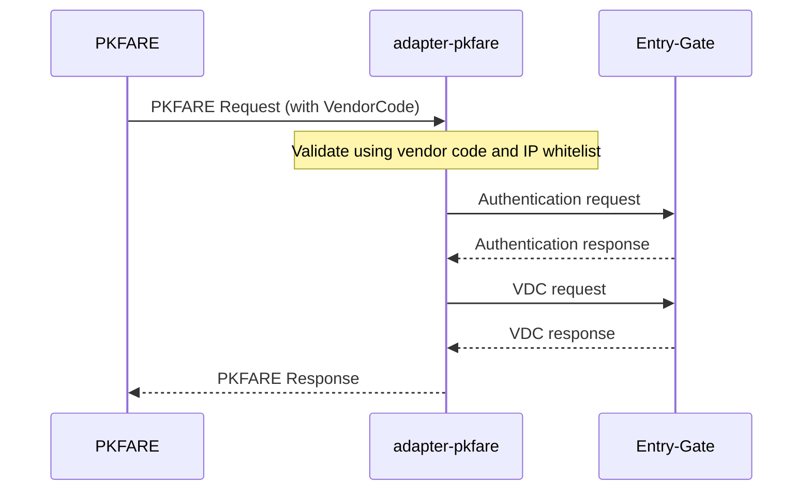

# PKFARE Integration

## Project Description

We are Verteil Technologies (VDC). This adapter is written for another airline aggregator PKFARE.
The primary aim for this connector or adapter microservice is to provide Verteil's API content to PKFARE in their format.

This adapter exposes endpoints according to PKFARE for them to consume.
Entry-Gate is Verteil's API microservice endpoint host for consuming airline content.

The general API flow looks like the following :



This connector/adapter in its current state is a boilerplate generated springboot app used to develop other Verteil's connector microservices. 
However, this is a reverse API integration, we are writing an adapter for PKFARE.

---

Initially only `SEARCH` API is to be done for an MVP.

### Things we have in hand

- Generated Schema classes of PKFARE under `com.verteil.schema.pkfare`
- Generated Schema classes of VDC under `com.verteil.schemas.ndc16_1`
- Connector Blueprint Markdown for reference (VietJet connector's) on how to build a connector microservice under [CONNECTOR_BLUEPRINT.md](../../../POD/TEMP/CONNECTOR_BLUEPRINT.md)
- Java Version : 25
- Gradle
- A one to one mapping included analysis report [search_analysis.md](../../../POD/PKFare/Services/SEARCH/search_analysis.md)
  - Request Analysis shows VDC (Verteil) fields to be mapped from PKFARE request
  - Response Analysis shows PKFARE fields to be mapped from VDC response

### Initial MVP Scope

- Setup this connector/adapter (rename this repo to be `adapter` instead of `connector` wherever possible)
  - To receive API request in PKFARE request format
  - Authenticate the request (Ip whitelist and vendor code validation)
  - Authenticate with entry-gate (Verteil microservice)
  - Convert PKFARE request to VDC Request and hit entry-gate
  - Recieve VDC Request, validate for errors
  - Convert to PKFARE response and send it back
- The endpoints of entry-gate will be database configured. (Ask if you have ambiguity in how it's done using blueprint provided)
- Implement appropriate caching
- Use blueprint for references. If not found search `../../connector-vj-v1` for reference
- The `SEARCH`, `QTE`, `Order`, `Order Status Push` APIs need to be configured on our end. 
- The `Get Pending Ticket Orders` and `Ticket Issuance` APIs are configured on PKFare's end, which we will call to issue a ticket.
- The services will be split into two groups
  - Offer
    - Search
    - QTE
  - Order
    - Order
    - Order Status Push
    - Get Pending Ticket Orders
    - Ticket Issuance
- Only `Search` API is to be implemented in the initial phase.


### Database Setup

Sample looks like 

```sql
-- To provide auth url of entry-gate (value will change, this is just a sample)
INSERT INTO ${configurator_tbls}.provider_api_configs(config_group, "name", carrier, iata, service, "version", value)
            VALUES('PKFARE_API', 'AUTH_PATH', NULL, NULL, NULL, NULL, '/oauth') ON CONFLICT DO NOTHING;
-- To give entry-gate host url
INSERT INTO ${configurator_tbls}.provider_api_configs(config_group, "name", carrier, iata, service, "version", value)
            VALUES('PKFARE_API', 'HOST', NULL, NULL, NULL, NULL, '<entry-gate-url>') ON CONFLICT DO NOTHING;
-- To give endpoints of entry-gate for each service
INSERT INTO ${configurator_tbls}.provider_api_configs(config_group, "name", carrier, iata, service, "version", value)
            VALUES('PKFARE_API', 'PATH', NULL, NULL, 'AirShopping', NULL, '/shopping') ON CONFLICT DO NOTHING;
-- To enable/disable the service provided by the connector
INSERT INTO ${configurator_tbls}.provider_api_configs(config_group, "name", carrier, iata, service, "version", value)
            VALUES('PKFARE_API', 'ENABLE_SERVICE', NULL, NULL, NULL, NULL, 'true') ON CONFLICT DO NOTHING;
-- To enable/disable individual services
INSERT INTO ${configurator_tbls}.provider_api_configs(config_group, "name", carrier, iata, service, "version", value)
            VALUES('PKFARE_API', 'ENABLE_SERVICE', NULL, NULL, 'AirShopping', NULL, 'true') ON CONFLICT DO NOTHING;
-- To provide timeout configs
INSERT INTO ${configurator_tbls}.provider_api_configs(config_group, "name", service, value)
            VALUES('VJ_API', 'TIMEOUT_MILLIS', 'AirShopping', '30000') ON CONFLICT DO NOTHING;
```

These are just samples, the actual db structure will be informed later. Analyze vj-connector to know more (if not in blueprint).
Prepare liquibase scripts regarding each db change grouped together according to relevance or similarity.


### Extras

- Ask if you are ambiguous or uncertain about any decision or if you have missing information
- An LLM document provided by PKFARE documentation is given in `./PKFARE_LLMs.txt` and its corresponding report that an LLM has already analyzed and made is in `./report.md`.